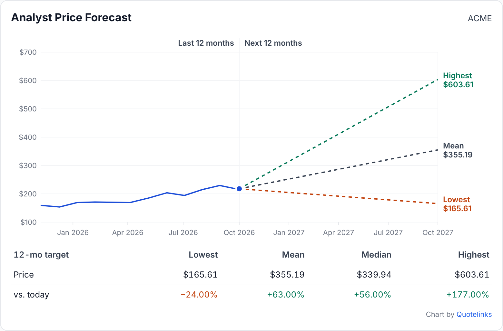
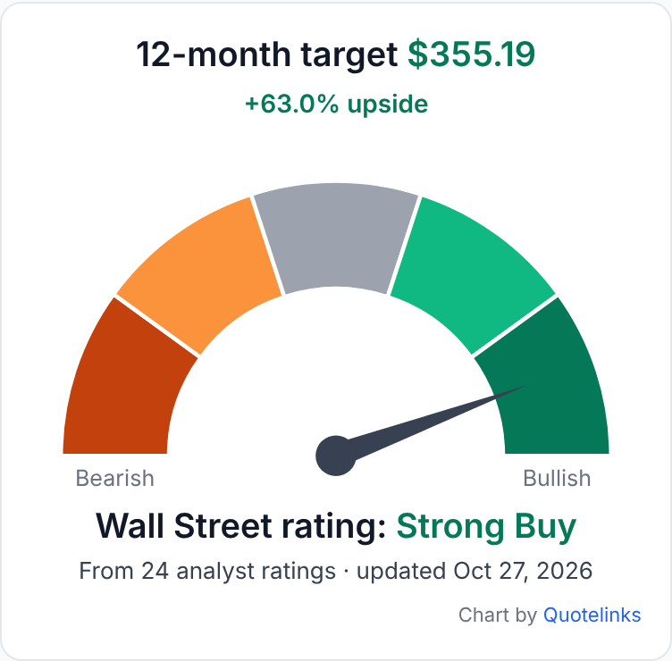
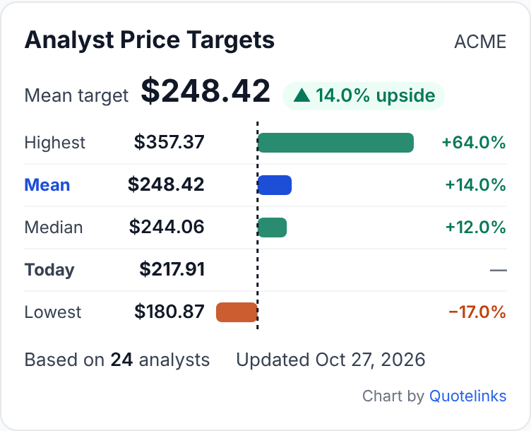
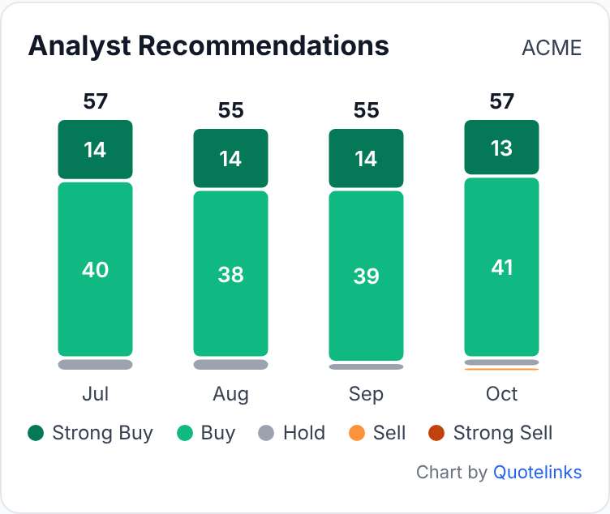
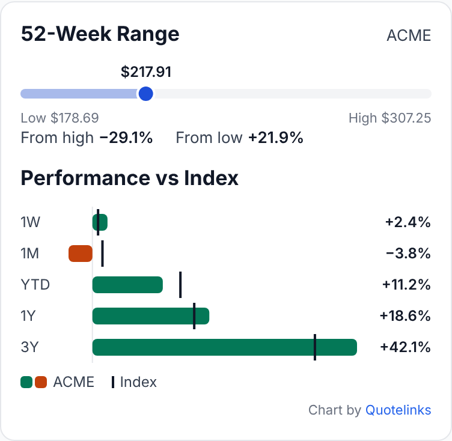
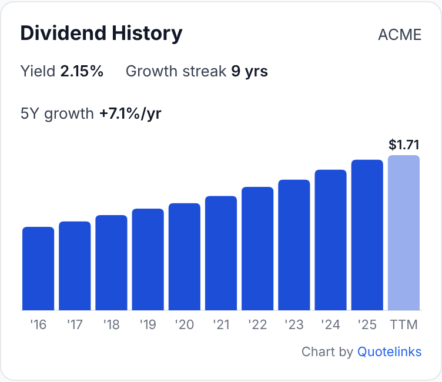
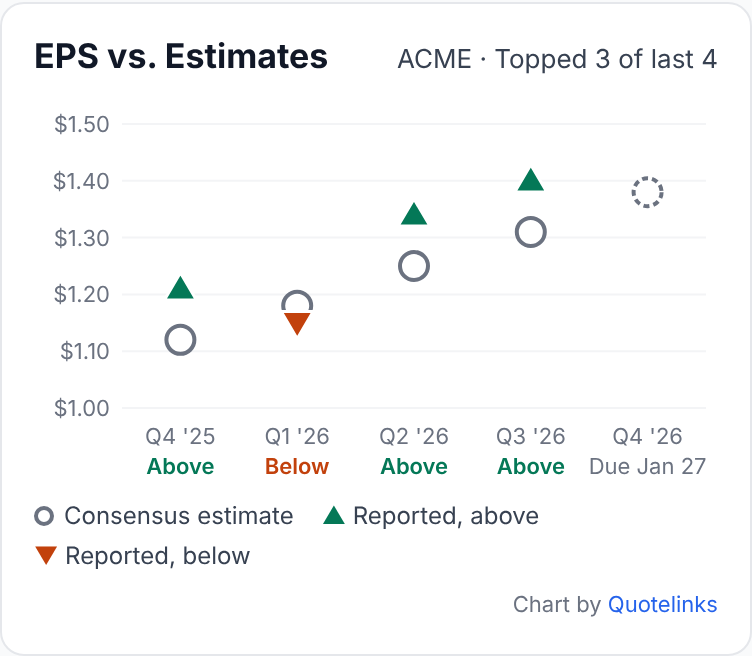

# Stock Charts

Free, zero-dependency **SVG stock chart widgets** for any website: analyst price targets, rating gauges, recommendation trends, price charts, 52-week range, dividends and earnings surprises.

You bring the JSON, and the library draws the chart. It doesn't fetch market data or need an API key, and it makes no network calls except to the `data-src` URL you give it.

**[Live demo](https://quotelinks.github.io/stock-charts/examples/)** · [Embedding examples](https://quotelinks.github.io/stock-charts/examples/embed.html) · [Data formats](#data-formats)



- ~31 KB minified (~11 KB gzipped), no dependencies, no build step
- 9 chart types, light / dark / auto themes
- Shadow DOM, so your site's CSS can't break the charts and theirs can't leak out
- Responsive from 240 px wide, with hover tooltips and ARIA labels
- Up and down values are never shown by color alone: there's always a sign, an arrow or a label
- MIT license

## Quick start

```html
<div class="ql-chart" data-type="target-range" data-src="/data/aapl-targets.json"></div>

<script src="https://cdn.jsdelivr.net/gh/quotelinks/stock-charts@1.0.1/dist/ql-charts.min.js" defer></script>
```

Every element with `class="ql-chart"` and a `data-type` is rendered when the page loads. The script can also be self-hosted: copy `dist/ql-charts.min.js` to your server.

### Three ways to supply data

**1. URL** (a static file or your own API endpoint):

```html
<div class="ql-chart" data-type="analyst-gauge" data-src="https://example.com/api/gauge?symbol=MSFT"></div>
```

**2. Inline JSON** (no extra request; good for server-rendered pages):

```html
<div class="ql-chart" data-type="analyst-ratings">
  <script type="application/json">
    {"symbol":"MSFT","strongBuy":11,"buy":8,"hold":4,"sell":1,"strongSell":0}
  </script>
</div>
```

**3. JavaScript API:**

```js
QLCharts.render(element, "price-chart", data, { theme: "dark", range: "6M" });
QLCharts.scan();   // render any .ql-chart elements added to the page after load
QLCharts.types;    // list of chart types
```

## Attributes

| Attribute | Values | Default |
|---|---|---|
| `data-type` | one of the [chart types](#chart-types) | required |
| `data-src` | URL that returns JSON (must allow CORS if it's on another domain) | none |
| `data-theme` | `light`, `dark`, `auto` (follows the operating system) | `light` |
| `data-frame` | `none` removes the card border and padding | card |
| `data-range` | `price-chart` only: `1M` `6M` `YTD` `1Y` `5Y` `Max` | `1Y` |
| `data-credit` | `off` hides the small "Chart by Quotelinks" link | shown |

The JS API takes the same options as `{ theme, frame, range, credit: false }`.

## Chart types

| Type | Shows | Screenshot |
|---|---|---|
| `price-target` | Past 12 months of prices + highest / mean / lowest analyst targets for the next 12 months, with a summary table | [view](docs/price-target.png) |
| `analyst-gauge` | Consensus rating gauge (bearish to bullish) with the 12-month target and upside | [view](docs/analyst-gauge.png) |
| `target-range` | Highest, mean, median and lowest targets vs. today's price, as bars | [view](docs/target-range.png) |
| `analyst-ratings` | Strong Buy … Strong Sell breakdown with counts and % | [view](docs/analyst-ratings.png) |
| `ratings-trend` | Monthly recommendation counts as stacked columns | [view](docs/ratings-trend.png) |
| `price-chart` | Area chart with 1M / 6M / YTD / 1Y / 5Y / Max range buttons and a crosshair | [view](docs/price-chart.png) |
| `range-performance` | 52-week range bar + returns vs. a benchmark | [view](docs/range-performance.png) |
| `dividend-history` | Dividends per share by year, yield, growth streak, 5-year growth rate | [view](docs/dividend-history.png) |
| `earnings-surprise` | EPS reported vs. consensus estimate by quarter, with the next report date | [view](docs/earnings-surprise.png) |

<p>



</p>
<p>



</p>

## Data formats

Each type has a JSON Schema in [`schemas/`](schemas/) and a sample file in [`examples/data/`](examples/data/). Dates are `YYYY-MM-DD`, percentages are plain numbers (`14.2` = 14.2%), and `currency` (ISO code, default `USD`) is optional everywhere.

```jsonc
// analyst-gauge
{ "symbol": "ACME", "price": 217.91, "target": 355.19, "consensus": 4.55, "analysts": 24, "asOf": "2026-10-27" }
// consensus: 1 = Strong Sell ... 5 = Strong Buy, or a label such as "Buy"

// price-target
{ "symbol": "ACME", "price": 217.91, "prices": [["2025-10-27", 160.1], ["2025-11-25", 155.2]],
  "low": 165.61, "average": 355.19, "median": 339.94, "high": 603.61, "horizonMonths": 12 }

// target-range
{ "symbol": "ACME", "price": 217.91, "low": 180.87, "average": 248.42, "median": 244.06, "high": 357.37, "analysts": 24, "asOf": "2026-10-27" }

// analyst-ratings
{ "symbol": "ACME", "strongBuy": 11, "buy": 8, "hold": 4, "sell": 1, "strongSell": 0 }

// ratings-trend  (optional "labels": {"sell": "Underperform"})
{ "symbol": "ACME", "periods": [ { "period": "Sep", "strongBuy": 14, "buy": 39, "hold": 2, "sell": 0, "strongSell": 0 } ] }

// price-chart  (daily closes, oldest first)
{ "symbol": "ACME", "name": "Acme Robotics", "prices": [["2025-10-28", 141.5], ["2025-10-29", 143.0]] }

// range-performance
{ "symbol": "ACME", "price": 217.91, "low52": 178.69, "high52": 307.25,
  "returns": { "1W": 2.4, "1M": -3.8, "YTD": 11.2, "1Y": 18.6 },
  "benchmark": { "name": "S&P 500", "returns": { "1W": 0.9, "1M": 1.6, "YTD": 14.0, "1Y": 16.2 } } }

// dividend-history
{ "symbol": "ACME", "yield": 2.15, "growthYears": 9, "annual": [[2024, 1.55], [2025, 1.66], ["TTM", 1.71, true]] }

// earnings-surprise  (omit "actual" for the upcoming report)
{ "symbol": "ACME", "quarters": [ { "period": "Q3 '26", "date": "2026-10-21", "estimate": 1.31, "actual": 1.40 },
                                  { "period": "Q4 '26", "date": "2027-01-27", "estimate": 1.38 } ] }
```

## Where to get data

This library ships no market data. Use any provider you are licensed to display (your broker's API, a market-data vendor, your own database) and output the formats above. All data in this repository is **fictional** (ticker ACME).

## Browser support

All current browsers (Chrome, Edge, Firefox, Safari, iOS, Android). Uses Shadow DOM, `fetch` and `ResizeObserver`.

## Credit link

Each chart shows a small "Chart by Quotelinks" link under it. It isn't required by the license and you can switch it off with `data-credit="off"`, but if the charts are useful to you, keeping it is appreciated.

## Related

- [Quotelinks stock widgets](https://github.com/quotelinks/quotelinks-stock-widgets): stock quote cards, ticker tapes and market movers with live data
- [Quotelinks](https://www.quotelinks.com/): free stock quotes, charts and screeners

## License

[MIT](LICENSE) © 2026 Quotelinks
